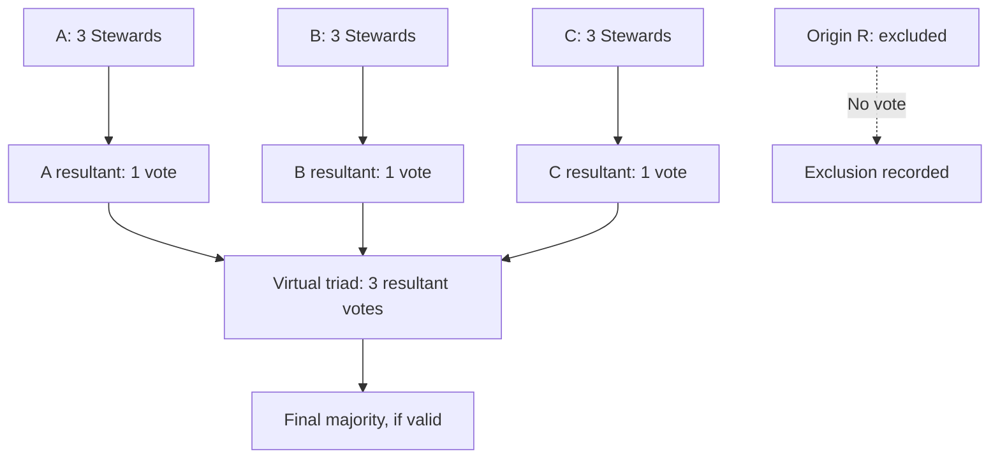
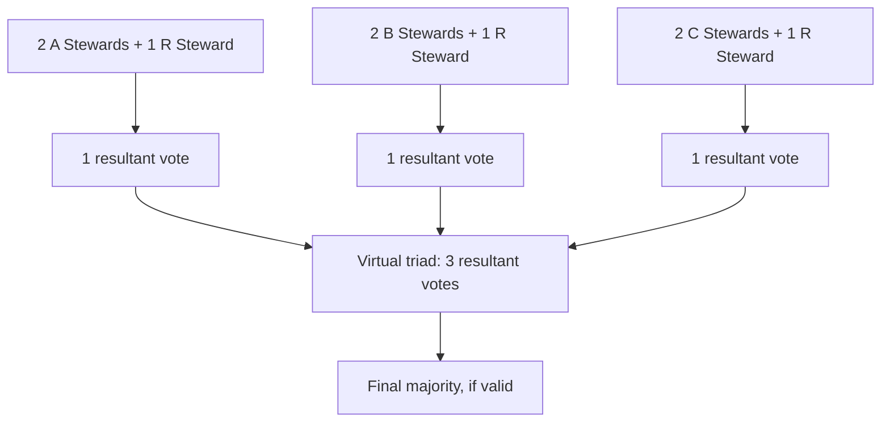

# Expanded Triadic Governance — Reconstruction and Spatial Diagrams 001

**Status:** Author-confirmed reconstruction; developmental, not canonical.  
**Date:** 11 October 2026  
**Companion:** Expanded Triadic Governance and Continuity Protocol — Reconstruction 001 (full standalone manuscript, pending repository transfer).  
**Provenance:** Original `ACBlainey/Concord/02_Operational_Systems/Governance Full.md`, especially Ch. 2 §2.11, Ch. 12 §12.1 and Ch. 14 §14.2.15–16; October 2026 author clarifications. The precise three-resultant voting geometry is author-restated, not a verbatim quotation from V1.

## 1. Reference spatial arrangement

The originating GTP triangle **R** has three edge-adjacent triangles **A**, **B**, and **C**. In the reference orientation A is below R; orientation labels are schematic and can be rotated or reflected. The mesh is spatial, **not** a governance hierarchy.

```text
                  /\
                 / B\
                /----\
               / \ R / \
              / C \ / A \
             /_____V_____\

R: originating triad
A, B, C: its three edge-adjacent triangles
```

Each triangle has three voting positions in the normal triadic process. **Each GTP vertex is represented by six Stewards in the wider mesh** (author-confirmed); this enables additional eligibility configurations, not six automatic votes at every point.

## 2. Origin-excluded expanded vote

The originating triad R does not vote. The three adjacent triads A, B and C each hold their own three-position vote. Each valid majority produces **one resultant vote**. Those three results form the final virtual triad.



**Do not pool the nine individual votes.** Example: A votes 2–1 For, B votes 2–1 For, C votes 3–0 Against. The nine individual ballots total 4 For versus 5 Against, but the virtual triad is **2 For versus 1 Against**. The expanded decision is For.

## 3. Origin-included expanded vote

Form three **mixed constituent triads**, each voting independently:
- **A + R:** two eligible Stewards from A, one eligible Steward from R.
- **B + R:** two eligible Stewards from B, one eligible Steward from R.
- **C + R:** two eligible Stewards from C, one eligible Steward from R.

Each mixed triad produces **one resultant vote**, and those three results form the final virtual triad. The three R contributions can be assigned to three distinct originating Stewards, subject to eligibility and independence rules.



The inclusion of R does **not** create a fourth final vote.

## 4. Voting outcomes and exceptional continuity

The ordinary decision rule requires a valid majority to authorise a state change. A constituent triad may produce **For**, **Against**, or **Unresolved** (for example, where abstention or invalid participation prevents a majority). Unresolved is not the same as a majority Against. An odd number of voting positions prevents a two-way tie only where all positions cast valid binary votes.

**Parallel Stewardship** in V1 is independent, advisory constitutional reasoning; it does **not** automatically grant executive voting authority. **Substitute Stewardship** is a separate, bounded, expressly authorised continuity mechanism. V1 Ch. 14 already discusses emergency substitutes, reduced participation, escalation and non-action. Parallel reasoning, substitutions, recusals, alternative eligible Stewards, and further mesh expansion require procedural safeguards so no mechanism can be used to manufacture a desired majority.

## 5. Recursive mesh and lowest capable level

**Golden rule:** Decide at the **lowest capable level** that has legitimate authority, sufficient information, competence, resources and ability to address material consequences. Expansion is exceptional, not an ordinary response to disagreement. GTP resolution is a spatial abstraction; spatial parent/child terminology creates no superior governance authority. Multiple spatial scales can operate simultaneously.

Further adjacent triangles may be brought into a bounded decision field when the initial arrangement cannot legitimately handle the matter. Any extended configuration must specify how it produces three independent resultant votes, eligibility, conflict checks, finite termination and audit. The mere presence of more triangles does not itself enlarge authority.

## 6. Large-area decisions: shared conditions do not imply one policy

Distinguish:
1. **Coordination:** sharing forecasts, resources, information and operational interfaces without transferring local decision authority.
2. **Federated local decisions:** each capable region makes its own lawful choice where effects can be contained.
3. **Aggregated shared decision:** used only for a genuinely common question requiring collective authority.
4. **Hybrid:** shared infrastructure coordination alongside distinct local policies.

**Hurricane example:** Five regions face the same storm. Four vote for mandatory evacuation and one votes against mandatory evacuation. The fifth region's vote is not automatically overridden by a 4–1 regional tally. Its lawful local choice may stand, subject to participant rights, material external effects and legitimate cross-boundary obligations. Evacuation routes, shelters, emergency resources and shared flood defences may separately require coordination or collective decisions.

## 7. Open formalisation work

Specify vertex-to-office mapping for the six-Steward representation; constituent selection and conflict checks; substitute appointment and succession; treatment of principled abstention; unresolved vote recovery; finite recursive expansion; voting independence across mixed triads; cross-boundary jurisdiction; rights and emergency safeguards; full audit and adversarial tests. Do not silently amend Governance V2 until reconciled and tested.

## 8. Preservation note

This file preserves the **author-confirmed spatial and voting core with GitHub-renderable diagrams**. It is a companion summary, **not a replacement for the longer standalone Reconstruction 001 manuscript or its generated infographic PNG**. The latter two require separate repository transfer to complete archival preservation.
