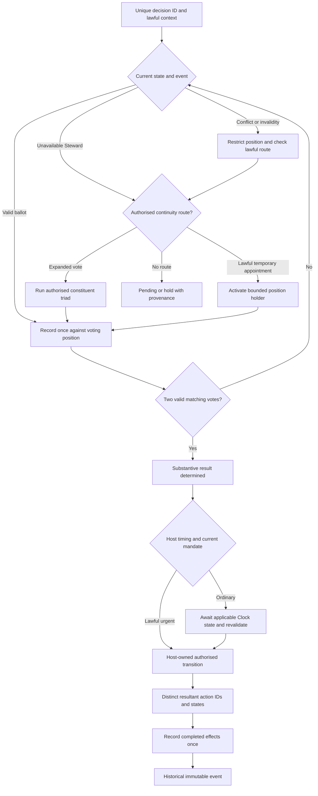

# Decision Event Boundary — Source-Limited Interface Review 018

**Status:** Provisional analysis, not canonical authority.

## Evidence consulted

- `Reconciled_Candidates/Chapter_12_Expanded_Triads_Reconciled_Candidate_007.md`, Git blob `134a4e061433de6ba50badd670f42ece9b727ce0`, is a provisional reconciled chapter, not enacted law. Its introductory status still says repeated origin Steward participation is unresolved; this conflicts with the later explicit one-Steward-one-position clarification and requires reconciliation.
- `Integration/Decision_Validity_and_Interface_Gates_006.md`, Git blob `5c95b967ad3a14a5e972015a09bcefaae96faab3`, distinguishes competence, forum, participation and result gates.
- `Validation/BVC_BTT_002_Result_Review_and_Decision_Boundary_017.md` records the second conceptual evaluator result and identifies R12 as unresolved.
- **Limitation:** An attempted direct fetch of `02_Domains/04_Governance/Governance V2 Canonical.md` returned an empty content field despite a blob SHA; therefore no claim is made that the complete canonical chapter text was searched in this pass. Existing source-preserving reconciliations remain separate evidence.

## Distinguish the relevant operations

1. **Constituent stage:** an internal part of one authorised decision; cannot gain an independent vote grant from a different identifier.
2. **Retry / receipt reconciliation:** a technical repeat or uncertain commit of the same decision; must not create a fresh vote or consequence.
3. **Continued deliberation:** the same unresolved question under the same authority; a new session is not automatically a new decision.
4. **Reconsideration:** may be a distinct decision only if the competent authority and applicable process independently permit it; a label is insufficient.
5. **Appeal / review:** a distinct lawful review forum may exercise its own bounded mandate, but the prior decision does not transfer authority to it automatically.
6. **Renewed mandate:** independently sourced authorisation for a new question or renewed decision, not a reset of expired authority by clerical renaming.
7. **Independent subsequent decision:** distinct legally operative question or event with separate basis; Steward may participate again if newly eligible and authorised.

## Provisional boundary rule

For a proposed vote stage S, the authoritative decision-event boundary must be resolved **before** assigning a new one-position-per-Steward uniqueness domain. A new `DecisionID` is merely a record label.

`BoundaryProof(S)` should identify: question and version; operative mandate; jurisdiction; intended consequence; constituent/continuation/retry/reconsideration/appeal relationship; independently authorised new event where claimed; and verified closure or commit state of related events.

Where a stage's separateness is materially unresolved, record `DECISION_BOUNDARY_UNKNOWN` and withhold operative commit. Do not silently count it as a new event, but do not permanently merge unrelated lawful decisions either.

## Counterexample and safeguard

A Steward occupies position A1 in constituent A, and an administrator creates a second ID for constituent B while the same substantive decision remains pending. The Steward is assigned B1 as well. Both local ballots could appear valid if each ID is treated as an independent decision. **Correct treatment:** resolve common decision-event ancestry, detect duplicate Steward across the combined position graph, and withhold. If separate decisions are independently established, uniqueness is checked within each legitimate event.

## Interfaces still requiring source resolution

- Exact legal meaning of a decision, reconsideration, appeal, review and closure.
- Whether appeal is a new substantive vote, a limited review of validity, or a different procedure.
- Who may authorise reconsideration and under what conditions.
- Privacy-preserving protected identity linking across the full event.
- Quorum and office mapping.
- Original standalone Triadic Governance Decision Protocol, still unrecovered.

**Disposition:** Candidate interface for a subsequent portable module revision and targeted negative tests. No automatic appeal, new authority, or jurisdiction is created by this review.

## Authorial resolution — historical decisions and new authority instances (12 October 2026)

**Authorial direction:** Once a decision has been completed and the relevant state machine has transitioned, the decision is a historical event. Its votes, outcome, authority, evidence and provenance are not reopened or rewritten. Any subsequent consideration of the same issue, including an appeal, remedy, challenge, changed circumstances or new evidence, is a **new decision instance** in the then-current state. That new instance requires its **own independently legitimate authority activation**, event identity, mandate, scope, participants and transition conditions. A new decision may change present/future effects or order lawful remedy, but cannot retroactively change the historical event. Repeated IDs, technical retries and duplicate receipts of an *unfinished* operation are not automatically independent decisions; establish the actual transition boundary and prevent double execution. This authorial resolution supersedes the earlier text's open question about whether a completed decision may be reopened; remaining implementation work concerns proof of completion, ancestry links, lawful new authority and idempotent execution.

## Authorial clarification — unique decision ID and state-gated idempotency (12 October 2026)

Every decision instance has a **unique identifier** bound to its own state-machine lifecycle. A vote or resultant action must reference that decision ID and be accepted only while the corresponding decision/action state permits the transition. Once the vote position or resultant action has transitioned, a repeated submission under that ID **cannot create a second vote, second state transition or duplicate consequence**. The same ID plus a changed terminal state supplies the primary duplicate-prevention rule. A duplicate message may arrive; it is rejected or recognised as an already-recorded receipt, never executed anew. Where one decision lawfully produces several distinct actions, each action needs its own identity/state **within the decision** to avoid confusing a legitimate different action with a duplicate of the same one. A new decision concerning the same historical issue must receive a **new unique ID** and fresh lawful authority activation; assigning a fresh ID alone never grants that authority. Record atomic/serialised state acceptance and durable receipts as implementation requirements for concurrent or retried requests, not as a new constitutional power. The completed decision remains historical and immutable.

## Authorial clarification — event-driven continuity branching (12 October 2026)

A uniquely identified decision instance is governed by its **current state and received event**. The state machine, rather than an operator inventing a new decision, routes eligible unresolved states to **already authorised** continuation mechanisms: awaiting an official ballot, permitted expanded-triad resultant, qualified and lawfully appointed temporary/parallel Steward, or a separately authorised provisional position vote. Which route applies depends on the specific event, state, conflict/absence cause and existing authority. These branches are not automatically available, and a parallel Steward's advisory assessment is not an official vote absent a lawful appointment. A completed two-matching-vote majority needs no third-position replacement merely for substantive validity. Each transition preserves the same unique decision ID; any distinct downstream action has its own action identity/state. Duplicate vote/action deliveries after transition cannot reproduce effects. Completed decisions become immutable history; later substantive consideration uses a new ID and fresh authority. Emergency protective action under a separate lawful mandate is not automatically a triadic vote. The Civilisation Clock is not an emergency transition gate.

**Provisional event-flow sketch (not executable or constitutionally graduated):**

**Remaining validation:** real event/state predicates; when expanded or parallel routes are legitimate; position and constituent result binding; atomic vote acceptance; idempotent resultant actions; paused-Clock emergency routing; immutable provenance and new-instance authority. A flowchart describes routing, not an independent grant of appointment or emergency powers.
