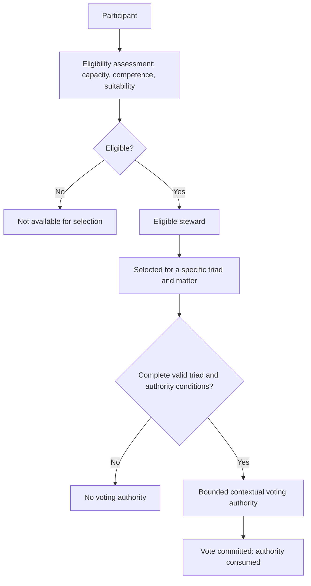

# Steward eligibility and contextual authority

This diagram distinguishes participation, eligibility, selection and bounded authority. Eligibility does not itself grant permanent governing authority. Detailed admission and accreditation criteria must be checked against V2.1.

