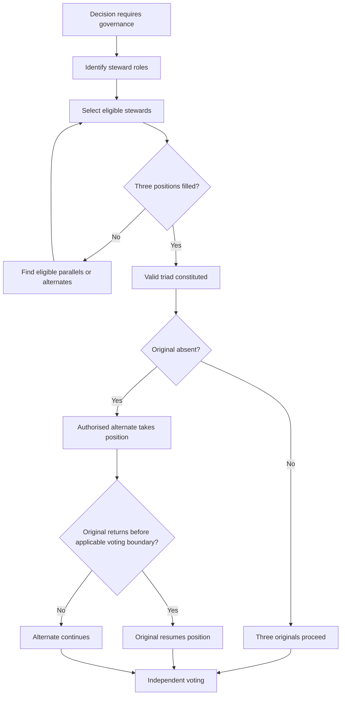

# Triad formation and alternate stewards

A complete triad requires three selected positions before voting authority can activate. If an original steward is absent, an authorised alternate can take the position. An original cannot be arbitrarily removed; a returning original may supersede an alternate subject to voting-stage conditions. Substitution does not create a fourth vote.

