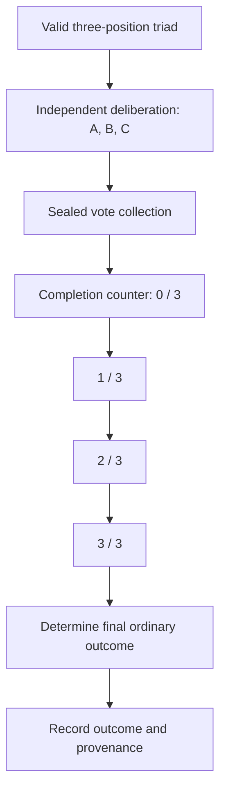

# Independent triadic voting

Each of three stewards deliberates independently and commits one irrevocable vote. The collection state machine can show the number of votes cast without exposing how anyone voted. This informational count does not change the authority combination-lock state. Ordinarily, no outcome is final until all three votes have been received. Once committed, a vote cannot be revoked, and the steward's authority for that act is consumed.

