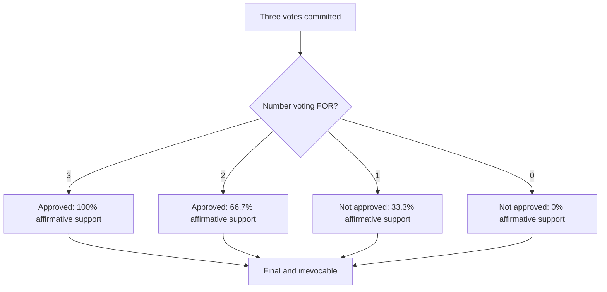

# Voting outcomes and confidence

All three votes matter equally. The affirmative support metric is the number of affirmative votes divided by three. Three for = 100%; two for = 66.7% (often expressed as 66%); one for = 33.3% (often 33%); zero for = 0%. Two matching affirmative votes produce an ordinary affirmative outcome only once all three votes are received. A missing vote is not a negative vote. The metric is vote support, not a statistical probability that a decision is correct.

