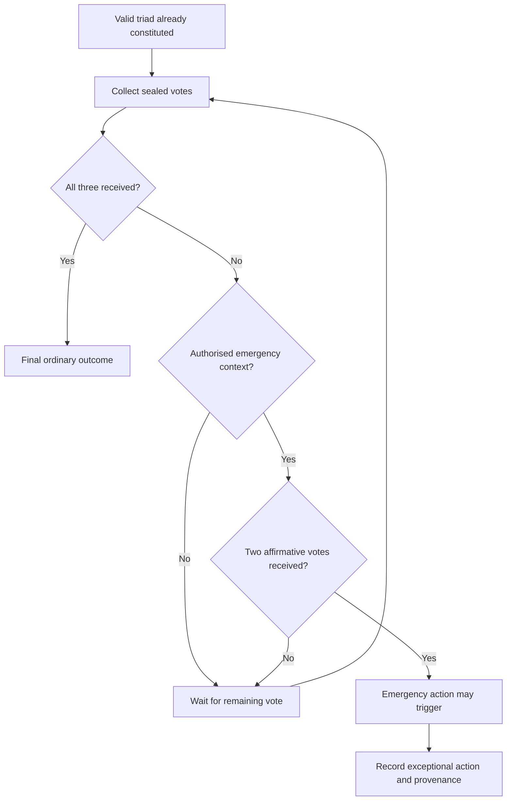

# Emergency voting exception

An emergency does not allow the creation of a two-person triad. Three steward positions must first have been selected. In an authorised emergency context, two affirmative votes can trigger action before the third vote arrives. Ordinary decisions await all three votes. The exceptional action and its provenance must be recorded.

