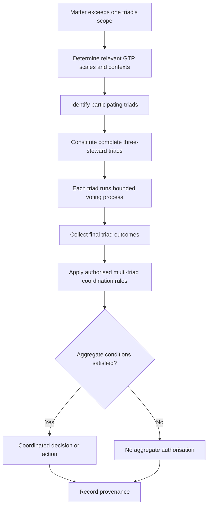

# Expanded voting and multi-triad coordination

When a matter exceeds a single triad's context or scope, multiple complete triads may operate and coordinate. GTP tessellation levels are conceptual and always present; several overlapping spatial scales can be active simultaneously. Coordination does not imply a permanent parent-child governance hierarchy. The precise aggregation rules require verification against the current V2.1 chapters; this is a conceptual diagram, not a newly established aggregation rule.

